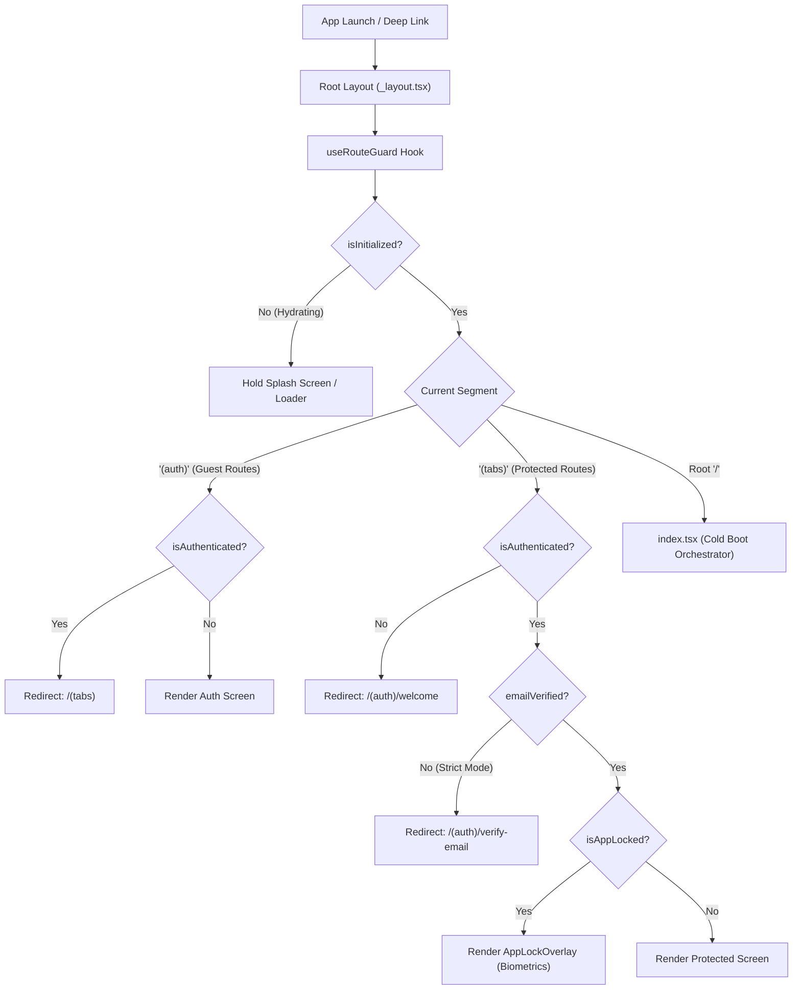
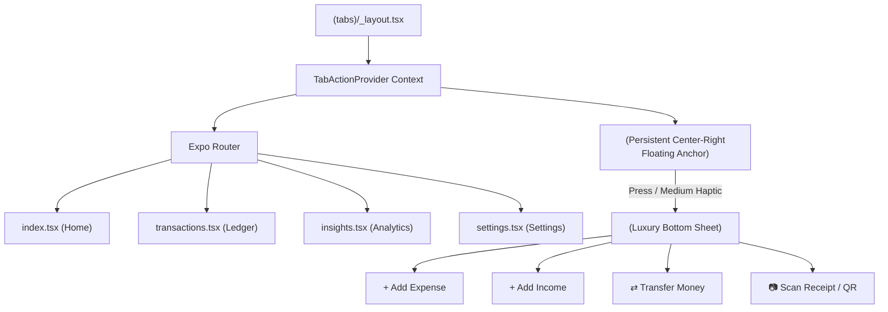

# Welcome to your Expo app 👋

This is an [Expo](https://expo.dev) project created with [`create-expo-app`](https://www.npmjs.com/package/create-expo-app).

## Get started

1. Install dependencies

   ```bash
   npm install
   ```

2. Start the app

   ```bash
   npx expo start
   ```

In the output, you'll find options to open the app in a

- [development build](https://docs.expo.dev/develop/development-builds/introduction/)
- [Android emulator](https://docs.expo.dev/workflow/android-studio-emulator/)
- [iOS simulator](https://docs.expo.dev/workflow/ios-simulator/)
- [Expo Go](https://expo.dev/go), a limited sandbox for trying out app development with Expo

You can start developing by editing the files inside the **src/app** directory. This project uses [file-based routing](https://docs.expo.dev/router/introduction).

## Get a fresh project

When you're ready, run:

```bash
npm run reset-project
```

This command will move the starter code to the **example** directory and create a blank **src/app** directory where you can start developing.

### Other setup steps

- To set up ESLint for linting, run `npx expo lint`, or follow our guide on ["Using ESLint and Prettier"](https://docs.expo.dev/guides/using-eslint/)
- If you'd like to set up unit testing, follow our guide on ["Unit Testing with Jest"](https://docs.expo.dev/develop/unit-testing/)
- Learn more about the TypeScript setup in this template in our guide on ["Using TypeScript"](https://docs.expo.dev/guides/typescript/)

## Learn more

To learn more about developing your project with Expo, look at the following resources:

- [Expo documentation](https://docs.expo.dev/): Learn fundamentals, or go into advanced topics with our [guides](https://docs.expo.dev/guides).
- [Learn Expo tutorial](https://docs.expo.dev/tutorial/introduction/): Follow a step-by-step tutorial where you'll create a project that runs on Android, iOS, and the web.

## Join the community

Join our community of developers creating universal apps.

- [Expo on GitHub](https://github.com/expo/expo): View our open source platform and contribute.
- [Discord community](https://chat.expo.dev): Chat with Expo users and ask questions.

import type { Config } from 'tailwindcss';

const config: Config = {
// Support both React Native (NativeWind v4) and Web
content: [
'./App.{js,jsx,ts,tsx}',
'./src/**/\*.{js,jsx,ts,tsx}',
'./apps/**/_.{js,jsx,ts,tsx}',
'./packages/\**/_.{js,jsx,ts,tsx}',
],
presets: [require('nativewind/preset')],
darkMode: 'class',
theme: {
extend: {
colors: {
kalya: {
/* Brand Primitives */
primary: {
DEFAULT: '#0d3e26', // Sovereign Emerald
dark: '#072617', // Vault Night
light: '#1b5e3a', // Forest Green
muted: '#257c4c',
},
gold: {
DEFAULT: '#d4af37', // Radiant Metallic Gold
warm: '#b8912e', // Burnished Deep Gold
soft: '#fdf3cd', // Champagne Gold Shimmer
dark: '#9a741c',
},
mint: {
DEFAULT: '#a3e6be', // Lucid Mint Sage
light: '#edfdf2', // Base Mint Canvas Wash
subtle: '#e1f7ea',
},
canvas: '#edfdf2',

          /* Standard / Solid UI Colors */
          surface: {
            DEFAULT: '#ffffff',
            subtle: '#f4fcf7',
            muted: '#e7f8ec',
            card: '#ffffff',
            raised: '#ffffff',
            dark: '#072617',
          },
          text: {
            primary: '#082919',
            secondary: '#2d5e46',
            tertiary: '#5d8a72',
            accent: '#9a741c',
            inverse: '#ffffff',
          },
          border: {
            subtle: '#cde8d7',
            DEFAULT: '#b2dbc0',
            strong: '#0d3e26',
            accent: '#d4af37',
          },

          /* Financial 50/30/20 & Flow Allocation */
          needs: '#0d3e26',
          wants: '#d4af37',
          savings: '#2d7a50',
          inflow: '#1b8a51',
          outflow: '#c83535',

          /* Liquid UI Refractive & Translucent Glass Tokens */
          glass: {
            'ultra-thin': 'rgba(255, 255, 255, 0.40)',
            base: 'rgba(255, 255, 255, 0.65)',
            thick: 'rgba(255, 255, 255, 0.82)',
            emerald: 'rgba(13, 62, 38, 0.88)',
            'emerald-dark': 'rgba(7, 38, 23, 0.95)',
            gold: 'rgba(212, 175, 55, 0.12)',
            'gold-strong': 'rgba(212, 175, 55, 0.25)',
            border: 'rgba(255, 255, 255, 0.65)',
            'border-emerald': 'rgba(255, 255, 255, 0.18)',
            'border-gold': 'rgba(212, 175, 55, 0.35)',
          },
        },
      },
      fontFamily: {
        outfit: ['Outfit-Regular', 'sans-serif'],
        'outfit-medium': ['Outfit-Medium', 'sans-serif'],
        'outfit-semibold': ['Outfit-SemiBold', 'sans-serif'],
        'outfit-bold': ['Outfit-Bold', 'sans-serif'],
      },
      borderRadius: {
        'kalya-xs': '6px',
        'kalya-sm': '10px',
        'kalya-md': '16px',
        'kalya-lg': '24px',
        'kalya-xl': '32px',
        'kalya-pill': '9999px',
      },
      boxShadow: {
        /* Standard Solid Elevation */
        'kalya-card': '0 2px 8px rgba(13, 62, 38, 0.05)',
        'kalya-elevated': '0 8px 24px rgba(13, 62, 38, 0.08)',
        'kalya-floating': '0 16px 40px rgba(13, 62, 38, 0.12)',

        /* Liquid UI Specular Depth & Glass Glows */
        'liquid-float': '0 14px 34px -8px rgba(13, 62, 38, 0.10), 0 4px 12px -2px rgba(13, 62, 38, 0.04)',
        'liquid-dock': '0 20px 48px -10px rgba(13, 62, 38, 0.18), 0 6px 16px -2px rgba(13, 62, 38, 0.06)',
        'liquid-emerald': '0 22px 50px -12px rgba(7, 38, 23, 0.45)',
        'liquid-inner-specular': 'inset 0 1px 1px 0 rgba(255, 255, 255, 0.75)',
        'liquid-inner-dual': 'inset 0 1px 1px 0 rgba(255, 255, 255, 0.8), inset 0 -1px 1px 0 rgba(13, 62, 38, 0.05)',
      },
      backdropBlur: {
        subtle: '12px',
        standard: '20px',
        dense: '32px',
        deep: '48px',
      },
    },

},
plugins: [],
};

export default config;

# @kalya/mobile: Offline Schema (Final)

Local SQLite schema for the offline-first mobile app. It reuses the column helpers from `packages/db` and mirrors the backend tables without any foreign keys to `user`.

## 1. Scope: 8 tables

| Table           | Source          | Purpose                      |
| --------------- | --------------- | ---------------------------- |
| `bucket`        | copy of backend | 50/30/20 buckets             |
| `category`      | copy of backend | expense categories           |
| `income`        | copy of backend | monthly income               |
| `budget`        | copy of backend | budget per bucket and income |
| `expense`       | copy of backend | main offline write path      |
| `goal`          | copy of backend | financial goals              |
| `sync_outbox`   | mobile only     | pending writes               |
| `sync_metadata` | mobile only     | sync cursor and state        |

Later, add `split_contact_member` and `split_expense` (10 tables), then `digital_asset` and `equity_asset` (12 tables). They follow the same pattern.

**Not stored locally:** `user`, `session`, `account`, `splitInvitation`, `alert`, `notificationPreference`, `pushSubscription`, `monthlySummary`, `jobQueue`, `auditLogs`, `contactInquiries`, `contactInquiryReplies`. These are server-driven, so fetch them online with React Query.

## 2. Reusing `packages/db` helpers

`_columns.ts` only imports `drizzle-orm` and `@kalya/utils`, so it is safe on the device. `_user-ref.ts` is **not** safe, because `userIdCol()` has `.references(() => user.id)` and the `user` table does not exist locally.

Add a subpath export in `packages/db/package.json` (adjust the path if `_columns.ts` lives in `src/schemas/`):

```json
"./columns": {
  "types": "./src/_columns.ts",
  "import": "./src/_columns.ts",
  "default": "./src/_columns.ts"
}
```

Add the matching path in `apps/mobile/tsconfig.json`:

```json
"paths": { "@kalya/db/columns": ["../../packages/db/src/_columns.ts"] }
```

## 3. Folder layout

```
apps/mobile/src/libs/db/
  client.ts
  sync-meta.ts
  schema/
    local-columns.ts
    finance.ts      # bucket, category, income, budget, expense, goal
    outbox.ts       # sync_outbox, sync_metadata
    index.ts
apps/mobile/drizzle.config.ts
```

## 4. `schema/local-columns.ts`

```typescript
import { text } from 'drizzle-orm/sqlite-core';
import { nullableTimestamp } from '@kalya/db/columns';

/** Owning user. Plain column: no FK, because there is no local user table. */
export const localUserIdCol = () => text('user_id').notNull();

/** Soft-delete marker. Required so delta sync can propagate deletes. */
export const deletedAtCol = () => nullableTimestamp('deleted_at');
```

## 5. `schema/finance.ts`

Same columns as the backend, with two differences: `userId` has no foreign key, and every table has `deletedAt`. All `*_id` columns are plain text with no `.references()`, because a pull can deliver a child row before its parent.

```typescript
import { index, real, sqliteTable, text } from 'drizzle-orm/sqlite-core';
import { boolCol, idCol, isoDate, money, timestamps, uuidCol } from '@kalya/db/columns';
import { deletedAtCol, localUserIdCol } from './local-columns';

export const bucket = sqliteTable(
  'bucket',
  {
    id: idCol(),
    userId: localUserIdCol(),
    key: text('key').notNull(),
    label: text('label').notNull(),
    origin: text('origin', { enum: ['built-in', 'custom'] }).notNull(),
    targetPercent: real('target_percent'),
    color: text('color'),
    icon: text('icon'),
    ...timestamps(),
    deletedAt: deletedAtCol(),
  },
  (t) => [
    index('bucket_user_idx').on(t.userId),
    index('bucket_user_updated_idx').on(t.userId, t.updatedAt),
  ]
);

export const category = sqliteTable(
  'category',
  {
    id: idCol(),
    userId: localUserIdCol(),
    bucketId: uuidCol('bucket_id').notNull(),
    key: text('key').notNull(),
    label: text('label').notNull(),
    origin: text('origin', { enum: ['built-in', 'custom'] }).notNull(),
    color: text('color').notNull(),
    icon: text('icon').notNull(),
    ...timestamps(),
    deletedAt: deletedAtCol(),
  },
  (t) => [
    index('category_user_bucket_idx').on(t.userId, t.bucketId),
    index('category_user_updated_idx').on(t.userId, t.updatedAt),
  ]
);

export const income = sqliteTable(
  'income',
  {
    id: idCol(),
    userId: localUserIdCol(),
    creditDate: text('credit_date').notNull(),
    month: text('month').notNull(), // "YYYY-MM"
    salary: money('salary', { notNull: true, default: 0 }),
    other: money('other', { notNull: true, default: 0 }),
    previousMonthLeft: money('previous_month_left', { notNull: true, default: 0 }),
    totalIncome: money('total_income', { notNull: true }),
    ...timestamps(),
    deletedAt: deletedAtCol(),
  },
  (t) => [
    index('income_user_month_idx').on(t.userId, t.month),
    index('income_user_updated_idx').on(t.userId, t.updatedAt),
  ]
);

export const budget = sqliteTable(
  'budget',
  {
    id: idCol(),
    userId: localUserIdCol(),
    bucketId: uuidCol('bucket_id').notNull(),
    incomeId: uuidCol('income_id').notNull(),
    period: text('period', {
      enum: ['monthly', 'quarterly', 'annual', 'financial_year'],
    })
      .notNull()
      .default('monthly'),
    amount: money('amount', { notNull: true }),
    alertThresholdAmber: real('alert_threshold_amber').notNull().default(80),
    alertThresholdRed: real('alert_threshold_red').notNull().default(100),
    rollover: boolCol('rollover', false),
    status: text('status', { enum: ['under', 'warning', 'over'] })
      .notNull()
      .default('under'),
    ...timestamps(),
    deletedAt: deletedAtCol(),
  },
  (t) => [
    index('budget_user_bucket_income_idx').on(t.userId, t.bucketId, t.incomeId),
    index('budget_user_updated_idx').on(t.userId, t.updatedAt),
  ]
);

export const expense = sqliteTable(
  'expense',
  {
    id: idCol(),
    userId: localUserIdCol(),
    date: isoDate('date').notNull(),
    categoryId: uuidCol('category_id').notNull(),
    description: text('description').notNull(),
    amount: money('amount', { notNull: true }),
    paymentMethod: text('payment_method', {
      enum: ['upi', 'phonepe', 'paytm', 'gpay', 'debit_card', 'credit_card'],
    }).default('upi'),
    isSplit: boolCol('is_split', false),
    paidBy: uuidCol('paid_by'), // split_contact_member.id (table not local in the core scope)
    yourShare: money('your_share', { notNull: true }),
    splitType: text('split_type', {
      enum: ['equal', 'exact', 'percentage', 'shares'],
    })
      .notNull()
      .default('equal'),
    ...timestamps(),
    deletedAt: deletedAtCol(),
  },
  (t) => [
    index('expense_user_category_split_idx').on(t.userId, t.categoryId, t.isSplit),
    index('expense_user_date_idx').on(t.userId, t.date),
    index('expense_user_updated_idx').on(t.userId, t.updatedAt),
  ]
);

export const goal = sqliteTable(
  'goal',
  {
    id: idCol(),
    userId: localUserIdCol(),
    bucketId: uuidCol('bucket_id').notNull(),
    name: text('name').notNull(),
    targetAmount: money('target_amount', { notNull: true }),
    targetDate: isoDate('target_date').notNull(),
    currentProgress: money('current_progress', { notNull: true, default: 0 }),
    monthlyContributionPlan: money('monthly_contribution_plan', { notNull: true, default: 0 }),
    status: text('status', {
      enum: ['not_started', 'in_progress', 'on_track', 'behind', 'completed', 'paused'],
    })
      .notNull()
      .default('not_started'),
    ...timestamps(),
    deletedAt: deletedAtCol(),
  },
  (t) => [
    index('goal_user_status_bucket_idx').on(t.userId, t.status, t.bucketId),
    index('goal_user_updated_idx').on(t.userId, t.updatedAt),
  ]
);

export type BucketRow = typeof bucket.$inferSelect;
export type CategoryRow = typeof category.$inferSelect;
export type IncomeRow = typeof income.$inferSelect;
export type BudgetRow = typeof budget.$inferSelect;
export type ExpenseRow = typeof expense.$inferSelect;
export type GoalRow = typeof goal.$inferSelect;
```

## 6. `schema/outbox.ts`

```typescript
import { index, integer, sqliteTable, text } from 'drizzle-orm/sqlite-core';
import { idCol, nullableTimestamp, timestamps, updatedAt } from '@kalya/db/columns';

export const OUTBOX_ENTITY_TYPES = [
  'bucket',
  'category',
  'income',
  'budget',
  'expense',
  'goal',
  'split_contact_member',
  'split_expense',
  'digital_asset',
  'equity_asset',
] as const;
export const OUTBOX_OPERATIONS = ['create', 'update', 'delete'] as const;
export const OUTBOX_STATUSES = ['pending', 'processing', 'failed'] as const;

export type OutboxEntityType = (typeof OUTBOX_ENTITY_TYPES)[number];
export type OutboxOperation = (typeof OUTBOX_OPERATIONS)[number];
export type OutboxStatus = (typeof OUTBOX_STATUSES)[number];

export const syncOutbox = sqliteTable(
  'sync_outbox',
  {
    id: idCol(), // also sent as the Idempotency-Key header
    entityType: text('entity_type', { enum: OUTBOX_ENTITY_TYPES }).notNull(),
    entityId: text('entity_id').notNull(),
    operation: text('operation', { enum: OUTBOX_OPERATIONS }).notNull(),
    payload: text('payload').notNull(), // JSON string shaped for the API
    status: text('status', { enum: OUTBOX_STATUSES }).notNull().default('pending'),
    attempts: integer('attempts').notNull().default(0),
    lastError: text('last_error'),
    nextRetryAt: nullableTimestamp('next_retry_at'),
    ...timestamps(),
  },
  (t) => [
    index('sync_outbox_status_created_idx').on(t.status, t.createdAt),
    index('sync_outbox_entity_idx').on(t.entityType, t.entityId),
  ]
);

export const syncMetadata = sqliteTable('sync_metadata', {
  key: text('key').primaryKey(),
  value: text('value').notNull(),
  updatedAt: updatedAt(),
});

export const SYNC_META_KEYS = {
  LAST_SYNC_CURSOR: 'last_sync_cursor', // server `serverTime` from last pull (ISO)
  LAST_SYNC_AT: 'last_sync_at', // device time, UI only
  USER_ID: 'user_id', // owner of local data
  SYNC_VERSION: 'sync_version', // forces resync after breaking changes
} as const;

export type SyncMetaKey = (typeof SYNC_META_KEYS)[keyof typeof SYNC_META_KEYS];
export type SyncOutboxRow = typeof syncOutbox.$inferSelect;
export type SyncMetadataRow = typeof syncMetadata.$inferSelect;
```

## 7. `schema/index.ts`, `client.ts`, `drizzle.config.ts`

```typescript
// schema/index.ts
export * from './finance';
export * from './outbox';
```

```typescript
// client.ts
import { openDatabaseSync } from 'expo-sqlite';
import { drizzle } from 'drizzle-orm/expo-sqlite';
import * as schema from './schema';

const expoDb = openDatabaseSync('kalya_local.db', { enableChangeListener: true });
expoDb.execSync('PRAGMA journal_mode = WAL;');

export { schema };
export const db = drizzle(expoDb, { schema });
export type MobileDatabase = typeof db;
```

```typescript
// drizzle.config.ts (apps/mobile)
import type { Config } from 'drizzle-kit';

export default {
  schema: './src/libs/db/schema/index.ts',
  out: './drizzle',
  dialect: 'sqlite',
  driver: 'expo',
} satisfies Config;
```

Run `drizzle-kit generate`, then apply the migrations at startup with `useMigrations(db, migrations)` from `drizzle-orm/expo-sqlite/migrator`. This needs `.sql` support in `metro.config.js` and `babel-plugin-inline-import` in `babel.config.js`.

```typescript
// sync-meta.ts
import { eq } from 'drizzle-orm';
import { db } from './client';
import { syncMetadata, type SyncMetaKey } from './schema/outbox';

export async function getMeta(key: SyncMetaKey) {
  const row = await db.select().from(syncMetadata).where(eq(syncMetadata.key, key)).get();
  return row?.value ?? null;
}

export async function setMeta(key: SyncMetaKey, value: string) {
  const now = new Date();
  await db
    .insert(syncMetadata)
    .values({ key, value, updatedAt: now })
    .onConflictDoUpdate({ target: syncMetadata.key, set: { value, updatedAt: now } });
}
```

## 8. Required backend changes (`packages/db` and `apps/api-server`)

The mobile schema depends on these. Without them delta sync and idempotency cannot work.

1. **Add `deleted_at`** (nullable `timestamp_ms`) to `bucket`, `category`, `income`, `budget`, `expense`, `goal`. Make the DELETE endpoints set it instead of removing the row. Every list query on the server must filter out soft-deleted rows.
2. **Add a changes endpoint**, e.g. `GET /api/v1/sync/changes?since=<iso>`. It returns every row for the user with `updated_at > since`, including soft-deleted ones, plus `serverTime`. Index `(user_id, updated_at)` on each table.
3. **Idempotent creates.** Accept the client-supplied `id` in the body. Insert with `onConflictDoNothing` on `id`. If the row already exists for the same user, return `200` with the existing row. If it belongs to another user, return a conflict.
4. **`Idempotency-Key` handling** for non-create side-effect endpoints, via a stored key table with a `(userId, key)` primary key and cached response.
5. **`generateId` format** must be accepted by the server validators (UUID v4, UUID v7, or whatever `@kalya/utils` produces).

## 9. Rules to keep

- **Money** is integer minor units (paise), as on the backend. Convert only at the UI edge.
- **Dates** like `expense.date` are ISO strings. Only `createdAt`, `updatedAt` and `deletedAt` are `timestamp_ms`. The API sends ISO strings for those, so convert in the entity mappers.
- **Set `createdAt` and `updatedAt` explicitly** in repository functions. The SQL default `unixepoch('subsecond')` needs SQLite 3.42 or newer, and `$onUpdate` only runs through Drizzle.
- **Pull upserts** take the server's `updatedAt` in the `set`, and skip rows that still have a pending outbox entry.
- **Every list query** filters `isNull(deletedAt)`. Use a shared `activeOnly(table)` helper.
- **Writes** go through repository functions that insert the local row and the outbox row in one transaction. Never write to a data table directly from a screen.
- **Outbox success** deletes the row. There is no `synced` status. `failed` rows stay for inspection or a manual retry.
- **Backoff:** on a retryable failure set `nextRetryAt = now + min(2^attempts * 1000, 300000)` ms plus jitter. The worker skips rows whose `nextRetryAt` is in the future.
- **Logout or user switch:** compare `SYNC_META_KEYS.USER_ID` with the signed-in user. If different, wipe all local data tables, `sync_outbox` and `sync_metadata` before syncing, so one user's pending writes are never pushed under another user's token.
- **Crash recovery:** reset rows stuck in `processing` back to `pending` once at app start, not on every sync run.
- **`generateId` in React Native:** if `@kalya/utils` uses Node's `crypto`, Metro will fail. Make it platform-neutral or use `expo-crypto`.
- **Keep schemas aligned:** add a type-level check that each mobile row type matches the backend row type, minus the new `deletedAt`.

## 10. Duplicate-write protection summary

| Duplicate source                             | Prevented by                                           |
| -------------------------------------------- | ------------------------------------------------------ |
| Double tap on Save                           | Disabled button, ID generated once per form            |
| Crash between local insert and outbox insert | Single transaction                                     |
| Overlapping sync runs                        | `running` guard and `processing` status                |
| Response lost, client retries                | Server `onConflictDoNothing` on client ID, returns 200 |
| Side-effect endpoints                        | `Idempotency-Key` table                                |
| Pull returns your own write                  | Upsert by primary key                                  |

## 11. Final checklist

- [ ] `./columns` subpath export and tsconfig path added
- [ ] `deleted_at` added to the 6 backend tables and DELETE endpoints soft-delete
- [ ] `GET /sync/changes` endpoint implemented and indexed
- [ ] Create endpoints idempotent on client `id`
- [ ] `generateId` verified in React Native
- [ ] Mobile schema files created and `drizzle-kit generate` run
- [ ] Migrations applied at app startup
- [ ] Repository layer writes data row and outbox row in one transaction
- [ ] Logout wipes local data and sync state

# Kalya Mobile — Architecture, Auth Guards & Tab System Plan

This document is the definitive master specification and implementation guide for `@kalya/mobile`. It covers two interconnected core architectural systems:

1. **Part 1: Authentication Protection, Route Guards & Session Security**
2. **Part 2: Tab Navigation Architecture & Global FAB Action Wrapper (`apps/mobile/src/app/(tabs)/*`)**

---

# PART 1: Authentication Protection, Route Guards & Session Security

## 1. Executive Summary & Objective

The fundamental authentication building blocks for `@kalya/mobile` (Zustand storage persistence, Expo SecureStore token handling, TanStack Query hooks, biometric authentication, and validation schemas) are fully in place.

Part 1 specifies the multi-tier route guarding and session synchronization needed to secure the client against unauthorized deep links, reverse guest access, expired token state drift, and background inactivity.

---

## 2. Security Architecture & Threat Model

### 2.1 Identified Vulnerabilities

1. **Unprotected Route Groups**: Direct deep-links or programmatic navigation into `/(tabs)` rendered protected screens without verifying tokens or authentication states.
2. **Reverse Access (Guest Routes)**: Authenticated users could navigate back into `/(auth)/sign-in` or `/(auth)/welcome`, resulting in contradictory UI states.
3. **Desynchronized 401 Responses**: When the server rejected a session token (HTTP 401), `axiosInstance` deleted the token from `SecureStore` but failed to reset `useAuthStore`'s `isAuthenticated` flag or redirect the user to login.
4. **App Resumption & Inactivity Vulnerability**: Financial dashboards remained visible in memory when switching apps. Without an inactivity/biometric lock, anyone accessing the unlocked phone could inspect personal financial records.
5. **App Switcher Snapshot Leak**: The operating system takes snapshots of apps when minimizing, potentially saving screenshots of account balances to disk.

### 2.2 Multi-Layer Defense Architecture



---

## 3. Route Guard Policy Matrix

| Route Group / Screen    | Required Auth State | Required Verification | Biometric Check               | Redirection If Policy Fails                  |
| :---------------------- | :------------------ | :-------------------- | :---------------------------- | :------------------------------------------- |
| **`src/app/index.tsx`** | Any                 | Any                   | Optional bootstrap check      | Dispatches to `/(tabs)` or `/(auth)/welcome` |
| **`src/app/(auth)/*`**  | Unauthenticated     | None                  | None                          | `/(tabs)` (if already logged in)             |
| **`src/app/(tabs)/*`**  | Authenticated       | Email Verified        | Active if enabled & timed out | `/(auth)/welcome` or `/(auth)/verify-email`  |
| **`src/app/(setup)/*`** | Authenticated       | Any                   | Optional                      | `/(tabs)` (if setup completed)               |

---

## 4. Auth Guards Production Code

### 4.1 Auth Store Updates — `apps/mobile/src/stores/auth/index.ts`

> **Purpose**: Add app lock state, inactivity timestamp tracking, and lock/unlock actions.

```typescript
import { create } from 'zustand';
import { persist, createJSONStorage } from 'zustand/middleware';
import AsyncStorage from '@react-native-async-storage/async-storage';
import type { Session, User } from '@kalya/types';

export interface AuthState {
  user: User | null;
  session: Session | null;
  isAuthenticated: boolean;
  isLoading: boolean;
  isInitialized: boolean;
  error: string | null;

  // Flow State
  pendingEmail: string | null;

  // Biometrics & App Lock
  isBiometricSupported: boolean;
  isBiometricEnrolled: boolean;
  isBiometricEnabled: boolean;
  /** Whether the application is temporarily locked due to background inactivity */
  isAppLocked: boolean;
  /** Unix timestamp in ms when the application was last moved to the background */
  lastBackgroundedAt: number | null;
}

export interface AuthActions {
  setUser: (user: User | null) => void;
  setSession: (session: Session | null) => void;
  setAuth: (user: User, session: Session) => void;
  updateUser: (partial: Partial<User>) => void;
  clearAuth: () => void;
  setLoading: (isLoading: boolean) => void;
  setInitialized: (isInitialized: boolean) => void;
  setError: (error: string | null) => void;
  setPendingEmail: (email: string | null) => void;

  // Biometrics & Lock Actions
  setBiometricSupported: (supported: boolean) => void;
  setBiometricEnrolled: (enrolled: boolean) => void;
  setBiometricEnabled: (enabled: boolean) => void;
  setAppLocked: (locked: boolean) => void;
  setLastBackgroundedAt: (timestamp: number | null) => void;
  unlockApp: () => void;
  reset: () => void;
}

export type AuthStore = AuthState & AuthActions;

const INITIAL_STATE: AuthState = {
  user: null,
  session: null,
  isAuthenticated: false,
  isLoading: true,
  isInitialized: false,
  error: null,
  pendingEmail: null,
  isBiometricSupported: false,
  isBiometricEnrolled: false,
  isBiometricEnabled: false,
  isAppLocked: false,
  lastBackgroundedAt: null,
};

export const useAuthStore = create<AuthStore>()(
  persist(
    (set) => ({
      ...INITIAL_STATE,

      setUser: (user) =>
        set((state) => ({
          user,
          isAuthenticated: Boolean(user && state.session),
          error: null,
        })),

      setSession: (session) =>
        set((state) => ({
          session,
          isAuthenticated: Boolean(state.user && session),
          error: null,
        })),

      setAuth: (user, session) =>
        set({
          user,
          session,
          isAuthenticated: true,
          isLoading: false,
          isInitialized: true,
          isAppLocked: false,
          error: null,
          pendingEmail: null,
        }),

      updateUser: (partial) =>
        set((state) => ({
          user: state.user ? { ...state.user, ...partial } : null,
        })),

      clearAuth: () =>
        set({
          user: null,
          session: null,
          isAuthenticated: false,
          isLoading: false,
          isInitialized: true,
          isAppLocked: false,
          error: null,
        }),

      setLoading: (isLoading) => set({ isLoading }),
      setInitialized: (isInitialized) => set({ isInitialized }),
      setError: (error) => set({ error }),
      setPendingEmail: (pendingEmail) => set({ pendingEmail }),

      setBiometricSupported: (isBiometricSupported) => set({ isBiometricSupported }),
      setBiometricEnrolled: (isBiometricEnrolled) => set({ isBiometricEnrolled }),
      setBiometricEnabled: (isBiometricEnabled) => set({ isBiometricEnabled }),
      setAppLocked: (isAppLocked) => set({ isAppLocked }),
      setLastBackgroundedAt: (lastBackgroundedAt) => set({ lastBackgroundedAt }),
      unlockApp: () => set({ isAppLocked: false }),

      reset: () =>
        set({
          ...INITIAL_STATE,
          isLoading: false,
          isInitialized: true,
        }),
    }),
    {
      name: 'kalya-mobile-auth-store',
      storage: createJSONStorage(() => AsyncStorage),
      partialize: (state) => ({
        user: state.user,
        session: state.session,
        isAuthenticated: state.isAuthenticated,
        isBiometricEnabled: state.isBiometricEnabled,
      }),
      onRehydrateStorage: () => (state) => {
        if (state) {
          state.setInitialized(true);
          state.setLoading(false);
        }
      },
    }
  )
);
```

---

### 4.2 Route Protection Hook — `apps/mobile/src/hooks/auth/use-route-guard.ts`

> **Purpose**: Global segment watcher enforcing guest vs protected route access.

```typescript
import { useEffect, useRef } from 'react';
import { useRouter, useSegments } from 'expo-router';
import { useAuthStore } from '@/stores/auth';

export interface RouteGuardOptions {
  requireVerifiedEmail?: boolean;
}

export function useRouteGuard(options: RouteGuardOptions = { requireVerifiedEmail: false }) {
  const router = useRouter();
  const segments = useSegments();

  const isInitialized = useAuthStore((s) => s.isInitialized);
  const isAuthenticated = useAuthStore((s) => s.isAuthenticated);
  const isLoading = useAuthStore((s) => s.isLoading);
  const user = useAuthStore((s) => s.user);

  const isRoutingRef = useRef(false);

  useEffect(() => {
    if (!isInitialized || isLoading) return;

    const rootSegment = segments[0];
    if (!rootSegment) return; // Keep splash active on root index.tsx

    const inAuthGroup = rootSegment === '(auth)';
    const inProtectedGroup = rootSegment === '(tabs)';

    if (isRoutingRef.current) return;

    // 1. Unauthenticated user trying to access tabs
    if (!isAuthenticated && inProtectedGroup) {
      isRoutingRef.current = true;
      router.replace('/(auth)/welcome');
      setTimeout(() => {
        isRoutingRef.current = false;
      }, 500);
      return;
    }

    // 2. Authenticated user trying to access guest routes
    if (isAuthenticated && inAuthGroup) {
      const currentScreen = segments[1];
      if (currentScreen === 'verify-email' && !user?.emailVerified) {
        return;
      }

      isRoutingRef.current = true;
      router.replace('/(tabs)');
      setTimeout(() => {
        isRoutingRef.current = false;
      }, 500);
      return;
    }

    // 3. Email verification enforcement
    if (
      isAuthenticated &&
      inProtectedGroup &&
      options.requireVerifiedEmail &&
      user &&
      !user.emailVerified
    ) {
      isRoutingRef.current = true;
      router.replace({
        pathname: '/(auth)/verify-email',
        params: { email: user.email },
      });
      setTimeout(() => {
        isRoutingRef.current = false;
      }, 500);
    }
  }, [
    isInitialized,
    isLoading,
    isAuthenticated,
    user?.emailVerified,
    user?.email,
    segments,
    router,
    options.requireVerifiedEmail,
  ]);
}
```

---

### 4.3 App Lock Hook & Overlay — `apps/mobile/src/hooks/auth/use-app-lock.ts`

```typescript
import { useEffect, useRef, useState } from 'react';
import { AppState, type AppStateStatus } from 'react-native';
import { useAuthStore } from '@/stores/auth';
import { useBiometric } from './use-biometric';

const DEFAULT_INACTIVITY_TIMEOUT_MS = 60 * 1000; // 60s

export function useAppLock(timeoutMs: number = DEFAULT_INACTIVITY_TIMEOUT_MS) {
  const appState = useRef<AppStateStatus>(AppState.currentState);
  const [isVeiled, setIsVeiled] = useState(false);

  const isAuthenticated = useAuthStore((s) => s.isAuthenticated);
  const isBiometricEnabled = useAuthStore((s) => s.isBiometricEnabled);
  const isAppLocked = useAuthStore((s) => s.isAppLocked);
  const lastBackgroundedAt = useAuthStore((s) => s.lastBackgroundedAt);

  const setAppLocked = useAuthStore((s) => s.setAppLocked);
  const setLastBackgroundedAt = useAuthStore((s) => s.setLastBackgroundedAt);
  const unlockApp = useAuthStore((s) => s.unlockApp);

  const { authenticateWithBiometrics, biometricLabel } = useBiometric();

  useEffect(() => {
    const handleAppStateChange = async (nextAppState: AppStateStatus) => {
      if (
        appState.current === 'active' &&
        (nextAppState === 'inactive' || nextAppState === 'background')
      ) {
        if (isAuthenticated && isBiometricEnabled) {
          setIsVeiled(true);
          setLastBackgroundedAt(Date.now());
        }
      }

      if (
        (appState.current === 'background' || appState.current === 'inactive') &&
        nextAppState === 'active'
      ) {
        setIsVeiled(false);

        if (isAuthenticated && isBiometricEnabled && lastBackgroundedAt) {
          const elapsed = Date.now() - lastBackgroundedAt;
          if (elapsed >= timeoutMs) {
            setAppLocked(true);
            await authenticateWithBiometrics(`Unlock Kalya with ${biometricLabel}`);
          }
        }
      }

      appState.current = nextAppState;
    };

    const subscription = AppState.addEventListener('change', handleAppStateChange);
    return () => subscription.remove();
  }, [
    isAuthenticated,
    isBiometricEnabled,
    lastBackgroundedAt,
    timeoutMs,
    setAppLocked,
    setLastBackgroundedAt,
    authenticateWithBiometrics,
    biometricLabel,
  ]);

  return {
    isAppLocked: isAuthenticated && isBiometricEnabled && isAppLocked,
    isVeiled,
    unlockApp,
  };
}
```

---

### 4.4 Axios 401 Interceptor Sync — `apps/mobile/src/libs/api/axios.ts`

```typescript
// Add inside axiosInstance.interceptors.response.use error handler:
if (statusCode === 401) {
  const reqUrl = err.config?.url || '';
  const isAuthApi =
    reqUrl.includes('/auth/get-session') ||
    reqUrl.includes('/auth/sign-in') ||
    reqUrl.includes('/auth/check-availability') ||
    reqUrl.includes('/auth/sign-up');

  if (!isAuthApi) {
    try {
      await SecureStore.deleteItemAsync(AUTH_TOKEN_KEY);
    } catch {}

    // Resets Zustand state -> triggers useRouteGuard redirect
    const { useAuthStore } = await import('@/stores/auth');
    useAuthStore.getState().clearAuth();

    if (!shouldSkipToast) {
      toast.warning('Your session has expired. Please sign in again.', {
        title: 'Session Expired',
      });
    }
  }
}
```

---

# PART 2: Tab Navigation Architecture & Global FAB Action Wrapper

## 1. Design Vision & Architectural Strategy

Kalya is a luxury wealth and financial intelligence mobile platform. The primary navigation experience must feel unified, responsive, and seamless across screens.

### 1.1 The Problem with Per-Screen FABs

In naive architectures, every screen in `(tabs)` (`index.tsx`, `transactions.tsx`, etc.) renders its own `<FAB>` and modal dialogs. This introduces severe UX defects:

1. **Flicker on Tab Switch**: The FAB unmounts and remounts when changing tabs, destroying fluid animations.
2. **Duplicate Modal & Sheet State**: Each tab repeats logic for "Add Expense", "Transfer", "Scan Receipt".
3. **Z-Index & Gesture Conflicts**: Floating elements battle with tab bar safe area insets and scroll views.

### 1.2 The Solution: The Layout-Level Global FAB Wrapper

By lifting the Floating Action Button (FAB) and Quick Action bottom sheet to the **Tab Navigator Layout (`(tabs)/_layout.tsx`)**:

- The FAB remains **mounted and persistent** across all tab switches.
- Any tab screen can dynamically control FAB visibility, badge counts, or context actions via a lightweight `useTabAction()` hook.
- A single, luxury-styled **Quick Actions Sheet** serves the entire app.
- Screens consume a standardized `<TabScreenWrapper>` that handles safe areas, status bars, and auto-hiding the FAB on downward scroll.

---

## 2. Tabs Hierarchy & Information Architecture

```
apps/mobile/src/app/(tabs)/
├── _layout.tsx           # Master Tab Navigator + TabActionProvider + Global FAB
├── index.tsx             # Home / Wealth Dashboard
├── transactions.tsx      # Transactions & Ledger
├── insights.tsx          # Analytics, Cashflow & Budgets
└── settings.tsx          # Profile, Security, Biometrics & Sign Out
```



---

## 3. Global FAB & Tab Action System Specification

### 3.1 Tab Action State Store & Context (`tab-action-provider.tsx`)

Exposes:

- `isFabVisible`: Boolean flag to reveal/hide the FAB.
- `activeModal`: Current open action modal (`'none' | 'quick-actions' | 'custom'`).
- `setFabVisible(visible: boolean)`: For screens that need full-screen space (e.g., settings or detail views).
- `openQuickActions()` / `closeQuickActions()`: Triggering the action bottom sheet.
- `fabAction`: Configurable primary action (defaults to opening Quick Actions).

### 3.2 Visual Design & Motion Tokens

- **Theme**: Sovereign Emerald (`#0d3e26`) base with Radiant Metallic Gold (`#d4af37`) accents.
- **FAB Elevation**: Anchored at `bottom: 92px` (resting directly above the bottom tab bar) and `right: 20px`.
- **Haptics**: Medium tactile click on FAB tap; Selection tick on quick action item select.
- **Spring Physics**: Smooth scale animation on press (`0.92` scale on press-in, `1.0` on release).

---

## 4. Complete Tab System Production Code

### File 1: Tab Action Context Provider — `apps/mobile/src/providers/tab-action-provider.tsx`

> **Purpose**: Central state management for the global tab FAB, scroll-to-hide triggers, and quick action sheet.

```typescript
import React, { createContext, useContext, useState, useCallback, useMemo } from 'react';

export type QuickActionType = 'expense' | 'income' | 'transfer' | 'scan';

export interface TabActionContextValue {
  /** Whether the global FAB is currently visible */
  isFabVisible: boolean;
  /** Sets FAB visibility (e.g. hidden on settings tab or during downward scroll) */
  setFabVisible: (visible: boolean) => void;
  /** Whether the quick actions bottom sheet is open */
  isQuickActionsOpen: boolean;
  /** Opens the quick actions bottom sheet */
  openQuickActions: () => void;
  /** Closes the quick actions bottom sheet */
  closeQuickActions: () => void;
  /** Dispatches a financial action event */
  triggerAction: (type: QuickActionType) => void;
  /** Custom handler override when FAB is tapped */
  customFabHandler?: (() => void) | null;
  /** Sets a temporary custom press handler for the FAB */
  setCustomFabHandler: (handler: (() => void) | null) => void;
}

const TabActionContext = createContext<TabActionContextValue | null>(null);

export interface TabActionProviderProps {
  children: React.ReactNode;
  onSelectAction?: (type: QuickActionType) => void;
}

export const TabActionProvider: React.FC<TabActionProviderProps> = ({
  children,
  onSelectAction,
}) => {
  const [isFabVisible, setFabVisible] = useState(true);
  const [isQuickActionsOpen, setIsQuickActionsOpen] = useState(false);
  const [customFabHandler, setCustomFabHandler] = useState<(() => void) | null>(null);

  const openQuickActions = useCallback(() => setIsQuickActionsOpen(true), []);
  const closeQuickActions = useCallback(() => setIsQuickActionsOpen(false), []);

  const triggerAction = useCallback(
    (type: QuickActionType) => {
      setIsQuickActionsOpen(false);
      if (onSelectAction) {
        onSelectAction(type);
      }
    },
    [onSelectAction]
  );

  const value = useMemo(
    () => ({
      isFabVisible,
      setFabVisible,
      isQuickActionsOpen,
      openQuickActions,
      closeQuickActions,
      triggerAction,
      customFabHandler,
      setCustomFabHandler,
    }),
    [
      isFabVisible,
      isQuickActionsOpen,
      openQuickActions,
      closeQuickActions,
      triggerAction,
      customFabHandler,
    ]
  );

  return <TabActionContext.Provider value={value}>{children}</TabActionContext.Provider>;
};

export function useTabAction(): TabActionContextValue {
  const context = useContext(TabActionContext);
  if (!context) {
    throw new Error('useTabAction must be used within a TabActionProvider');
  }
  return context;
}
```

---

### File 2: Luxury Quick Actions Modal — `apps/mobile/src/components/shared/tabs-quick-action-modal.tsx`

> **Purpose**: Sovereign-styled bottom sheet offering instant access to Add Expense, Add Income, Transfer, and Scan Receipt.

```typescript
import React from 'react';
import { View, Modal, Pressable } from 'react-native';
import { ArrowDownLeft, ArrowUpRight, ArrowLeftRight, ScanLine, X } from 'lucide-react-native';
import { Typo, HapticTouchable } from '@/components/ui';
import { triggerHaptic } from '@/components/ui/primitives/haptic-touchable';
import { useTabAction, type QuickActionType } from '@/providers/tab-action-provider';

interface ActionItem {
  type: QuickActionType;
  title: string;
  subtitle: string;
  icon: React.ReactNode;
  accentBg: string;
}

const ACTIONS: ActionItem[] = [
  {
    type: 'expense',
    title: 'Record Expense',
    subtitle: 'Track spending, bills & outflows',
    icon: <ArrowUpRight size={22} color="#dc2626" />,
    accentBg: 'bg-red-50 dark:bg-red-950/40 border-red-200',
  },
  {
    type: 'income',
    title: 'Log Income',
    subtitle: 'Deposit, salary, dividends or capital',
    icon: <ArrowDownLeft size={22} color="#0d3e26" />,
    accentBg: 'bg-kalya-mint-subtle border-kalya-border-subtle',
  },
  {
    type: 'transfer',
    title: 'Transfer Money',
    subtitle: 'Move funds across linked accounts',
    icon: <ArrowLeftRight size={22} color="#9a741c" />,
    accentBg: 'bg-amber-50 dark:bg-amber-950/40 border-amber-200',
  },
  {
    type: 'scan',
    title: 'Scan Receipt',
    subtitle: 'Auto-extract bill with optical AI',
    icon: <ScanLine size={22} color="#0d3e26" />,
    accentBg: 'bg-kalya-mint-subtle border-kalya-border-subtle',
  },
];

export const TabsQuickActionModal: React.FC = () => {
  const { isQuickActionsOpen, closeQuickActions, triggerAction } = useTabAction();

  if (!isQuickActionsOpen) return null;

  const handleSelect = (type: QuickActionType) => {
    triggerHaptic('selection');
    triggerAction(type);
  };

  return (
    <Modal
      visible={isQuickActionsOpen}
      transparent
      animationType="fade"
      onRequestClose={closeQuickActions}
      statusBarTranslucent
    >
      <View className="flex-1 justify-end bg-black/50">
        <Pressable className="flex-1" onPress={closeQuickActions} />

        <View className="bg-kalya-canvas rounded-t-3xl border-t border-kalya-border-subtle p-6 pb-12 shadow-2xl">
          <View className="w-12 h-1.5 rounded-full bg-kalya-border-subtle self-center mb-6" />

          <View className="flex-row items-center justify-between mb-6">
            <View>
              <Typo variant="title-md" className="text-kalya-text-primary font-outfit-bold">
                Quick Actions
              </Typo>
              <Typo variant="body-sm" tone="secondary">
                Instantly execute financial transactions
              </Typo>
            </View>
            <HapticTouchable
              onPress={closeQuickActions}
              hapticTier="light"
              className="h-9 w-9 rounded-full bg-kalya-surface-subtle items-center justify-center border border-kalya-border-subtle"
            >
              <X size={18} color="#0d3e26" />
            </HapticTouchable>
          </View>

          <View className="gap-3">
            {ACTIONS.map((action) => (
              <HapticTouchable
                key={action.type}
                onPress={() => handleSelect(action.type)}
                hapticTier="medium"
                className="flex-row items-center p-4 rounded-2xl bg-white border border-kalya-border-subtle shadow-sm active:scale-[0.98]"
              >
                <View
                  className={`h-12 w-12 rounded-xl items-center justify-center border ${action.accentBg} mr-4`}
                >
                  {action.icon}
                </View>
                <View className="flex-1">
                  <Typo variant="body-md" className="font-inter-bold text-kalya-text-primary">
                    {action.title}
                  </Typo>
                  <Typo variant="caption" tone="secondary">
                    {action.subtitle}
                  </Typo>
                </View>
              </HapticTouchable>
            ))}
          </View>
        </View>
      </View>
    </Modal>
  );
};
```

---

### File 3: Persistent Tab FAB Component — `apps/mobile/src/components/shared/tabs-fab.tsx`

> **Purpose**: Floating button permanently positioned above the tab bar with haptic feedback and spring motion.

```typescript
import React from 'react';
import { View } from 'react-native';
import { Plus } from 'lucide-react-native';
import Animated, { FadeIn, FadeOut, LinearTransition } from 'react-native-reanimated';
import { HapticTouchable } from '@/components/ui/primitives/haptic-touchable';
import { useTabAction } from '@/providers/tab-action-provider';

export interface TabsFabProps {
  /** Optional custom position override */
  className?: string;
}

export const TabsFab: React.FC<TabsFabProps> = () => {
  const { isFabVisible, openQuickActions, customFabHandler } = useTabAction();

  if (!isFabVisible) return null;

  const handlePress = () => {
    if (customFabHandler) {
      customFabHandler();
    } else {
      openQuickActions();
    }
  };

  return (
    <Animated.View
      entering={FadeIn.duration(200)}
      exiting={FadeOut.duration(150)}
      layout={LinearTransition}
      className="absolute bottom-24 right-5 z-40"
      pointerEvents="box-none"
    >
      <HapticTouchable
        accessibilityRole="button"
        accessibilityLabel="Open Quick Financial Actions"
        hapticTier="medium"
        onPress={handlePress}
        className="h-14 w-14 rounded-full bg-kalya-primary border-2 border-kalya-gold items-center justify-center shadow-xl active:scale-95"
      >
        <Plus size={26} color="#ffffff" strokeWidth={2.6} />
      </HapticTouchable>
    </Animated.View>
  );
};
```

---

### File 4: Reusable Tab Screen Wrapper — `apps/mobile/src/components/shared/tab-screen-wrapper.tsx`

> **Purpose**: Wraps each tab screen's content to enforce safe area insets, pull-to-refresh, header spacing, and scroll-to-hide FAB behavior.

```typescript
import React, { useRef } from 'react';
import {
  ScrollView,
  View,
  RefreshControl,
  type NativeSyntheticEvent,
  type NativeScrollEvent,
} from 'react-native';
import { useSafeAreaInsets } from 'react-native-safe-area-context';
import { StatusBar } from 'expo-status-bar';
import { useTabAction } from '@/providers/tab-action-provider';
import { cn } from '@/libs/utils';

export interface TabScreenWrapperProps {
  children: React.ReactNode;
  /** Whether content should scroll */
  scrollable?: boolean;
  /** Pull to refresh callback */
  onRefresh?: () => void;
  /** Pull to refresh loading state */
  refreshing?: boolean;
  /** Optional custom header component */
  header?: React.ReactNode;
  /** Auto-hide FAB when scrolling down */
  autoHideFabOnScroll?: boolean;
  className?: string;
}

export const TabScreenWrapper: React.FC<TabScreenWrapperProps> = ({
  children,
  scrollable = true,
  onRefresh,
  refreshing = false,
  header,
  autoHideFabOnScroll = true,
  className,
}) => {
  const insets = useSafeAreaInsets();
  const { setFabVisible } = useTabAction();
  const lastScrollY = useRef(0);

  const handleScroll = (event: NativeSyntheticEvent<NativeScrollEvent>) => {
    if (!autoHideFabOnScroll) return;
    const currentY = event.nativeEvent.contentOffset.y;

    if (currentY > lastScrollY.current + 25 && currentY > 50) {
      setFabVisible(false); // Scrolling down -> hide FAB
    } else if (currentY < lastScrollY.current - 15) {
      setFabVisible(true); // Scrolling up -> show FAB
    }

    lastScrollY.current = currentY;
  };

  // Safe bottom padding so scrollable content does not get blocked by tab bar and FAB
  const bottomPadding = insets.bottom + 88;

  return (
    <View className={cn('flex-1 bg-kalya-canvas', className)}>
      <StatusBar style="dark" />
      <View style={{ paddingTop: insets.top }}>{header}</View>

      {scrollable ? (
        <ScrollView
          className="flex-1 w-full"
          contentContainerStyle={{ paddingBottom: bottomPadding, flexGrow: 1 }}
          showsVerticalScrollIndicator={false}
          onScroll={handleScroll}
          scrollEventThrottle={16}
          refreshControl={
            onRefresh ? (
              <RefreshControl
                refreshing={refreshing}
                onRefresh={onRefresh}
                tintColor="#0d3e26"
                colors={['#0d3e26', '#d4af37']}
              />
            ) : undefined
          }
        >
          {children}
        </ScrollView>
      ) : (
        <View className="flex-1" style={{ paddingBottom: bottomPadding }}>
          {children}
        </View>
      )}
    </View>
  );
};
```

---

### File 5: Master Tab Navigator Layout — `apps/mobile/src/app/(tabs)/_layout.tsx`

> **Purpose**: Configures the Expo Router tab bar, registers tab routes, wraps with `TabActionProvider`, and embeds the persistent `<TabsFab />` and `<TabsQuickActionModal />`.

```typescript
import React, { useEffect } from 'react';
import { View, ActivityIndicator, Platform } from 'react-native';
import { Tabs, useRouter } from 'expo-router';
import { LayoutDashboard, ReceiptText, PieChart, Settings } from 'lucide-react-native';
import { useAuth } from '@/hooks/auth';
import { TabActionProvider, type QuickActionType } from '@/providers/tab-action-provider';
import { TabsFab } from '@/components/shared/tabs-fab';
import { TabsQuickActionModal } from '@/components/shared/tabs-quick-action-modal';
import { toast } from '@/components/ui/feedback/toast';

export default function TabsLayout() {
  const router = useRouter();
  const { isAuthenticated, isInitialized, isLoading } = useAuth();

  // Authentication barrier: redirect unauthenticated users to welcome
  useEffect(() => {
    if (isInitialized && !isLoading && !isAuthenticated) {
      router.replace('/(auth)/welcome');
    }
  }, [isInitialized, isLoading, isAuthenticated, router]);

  if (!isInitialized || isLoading) {
    return (
      <View className="flex-1 bg-kalya-canvas items-center justify-center">
        <ActivityIndicator size="small" color="#0d3e26" />
      </View>
    );
  }

  if (!isAuthenticated) return null;

  const handleQuickAction = (type: QuickActionType) => {
    switch (type) {
      case 'expense':
        toast.info('Navigate to Add Expense form');
        break;
      case 'income':
        toast.info('Navigate to Log Income form');
        break;
      case 'transfer':
        toast.info('Navigate to Transfer Money form');
        break;
      case 'scan':
        toast.info('Open Receipt Camera Scanner');
        break;
    }
  };

  return (
    <TabActionProvider onSelectAction={handleQuickAction}>
      <View className="flex-1">
        <Tabs
          screenOptions={{
            headerShown: false,
            tabBarShowLabel: true,
            tabBarActiveTintColor: '#0d3e26', // Sovereign Emerald
            tabBarInactiveTintColor: '#7a9f8b', // Muted sage
            tabBarStyle: {
              backgroundColor: '#ffffff',
              borderTopColor: '#cde8d7',
              borderTopWidth: 1,
              height: Platform.OS === 'ios' ? 88 : 68,
              paddingBottom: Platform.OS === 'ios' ? 30 : 10,
              paddingTop: 10,
              elevation: 8,
              shadowColor: '#000000',
              shadowOffset: { width: 0, height: -2 },
              shadowOpacity: 0.05,
              shadowRadius: 6,
            },
            tabBarLabelStyle: {
              fontFamily: 'Inter-Bold',
              fontSize: 11,
              marginTop: 2,
            },
          }}
        >
          {/* 1. Overview / Dashboard */}
          <Tabs.Screen
            name="index"
            options={{
              title: 'Overview',
              tabBarIcon: ({ color, size }) => <LayoutDashboard size={size} color={color} />,
            }}
          />

          {/* 2. Transactions */}
          <Tabs.Screen
            name="transactions"
            options={{
              title: 'Transactions',
              tabBarIcon: ({ color, size }) => <ReceiptText size={size} color={color} />,
            }}
          />

          {/* 3. Insights */}
          <Tabs.Screen
            name="insights"
            options={{
              title: 'Insights',
              tabBarIcon: ({ color, size }) => <PieChart size={size} color={color} />,
            }}
          />

          {/* 4. Settings */}
          <Tabs.Screen
            name="settings"
            options={{
              title: 'Settings',
              tabBarIcon: ({ color, size }) => <Settings size={size} color={color} />,
            }}
          />
        </Tabs>

        {/* Global Floating Action Button for ALL Tabs */}
        <TabsFab />

        {/* Global Quick Actions Bottom Sheet */}
        <TabsQuickActionModal />
      </View>
    </TabActionProvider>
  );
}
```

---

### File 6: Tab Screen Implementations

#### Tab 1: `apps/mobile/src/app/(tabs)/index.tsx` (Dashboard)

```typescript
import React from 'react';
import { View } from 'react-native';
import { TabScreenWrapper } from '@/components/shared/tab-screen-wrapper';
import { Typo } from '@/components/ui';
import { useAuth } from '@/hooks/auth';

export default function DashboardScreen() {
  const { user } = useAuth();

  return (
    <TabScreenWrapper
      header={
        <View className="px-6 py-4 flex-row items-center justify-between border-b border-kalya-border-subtle bg-white">
          <View>
            <Typo variant="caption" tone="secondary">
              Welcome back
            </Typo>
            <Typo variant="title-md" className="font-outfit-bold text-kalya-text-primary">
              {user?.name || user?.username}
            </Typo>
          </View>
        </View>
      }
    >
      <View className="p-6 gap-6">
        {/* Total Net Worth Card */}
        <View className="p-6 rounded-3xl bg-kalya-primary border border-kalya-border-strong shadow-lg">
          <Typo variant="caption" className="text-kalya-mint uppercase tracking-wider font-inter-bold">
            Total Net Worth
          </Typo>
          <Typo variant="display" className="text-white font-outfit-bold mt-2">
            $148,290.50
          </Typo>
          <View className="flex-row items-center mt-4 gap-2">
            <View className="px-2.5 py-1 rounded-full bg-kalya-mint/20 border border-kalya-mint/30">
              <Typo variant="caption" className="text-kalya-mint font-inter-bold">
                +12.4% this month
              </Typo>
            </View>
          </View>
        </View>
      </View>
    </TabScreenWrapper>
  );
}
```

#### Tab 2: `apps/mobile/src/app/(tabs)/transactions.tsx` (Ledger)

```typescript
import React from 'react';
import { View } from 'react-native';
import { TabScreenWrapper } from '@/components/shared/tab-screen-wrapper';
import { Typo } from '@/components/ui';

export default function TransactionsScreen() {
  return (
    <TabScreenWrapper
      header={
        <View className="px-6 py-4 border-b border-kalya-border-subtle bg-white">
          <Typo variant="title-md" className="font-outfit-bold text-kalya-text-primary">
            Transactions
          </Typo>
        </View>
      }
    >
      <View className="p-6">
        <Typo variant="body-md" tone="secondary">
          Recent ledger activity will be listed here.
        </Typo>
      </View>
    </TabScreenWrapper>
  );
}
```

#### Tab 3: `apps/mobile/src/app/(tabs)/insights.tsx` (Analytics)

```typescript
import React from 'react';
import { View } from 'react-native';
import { TabScreenWrapper } from '@/components/shared/tab-screen-wrapper';
import { Typo } from '@/components/ui';

export default function InsightsScreen() {
  return (
    <TabScreenWrapper
      header={
        <View className="px-6 py-4 border-b border-kalya-border-subtle bg-white">
          <Typo variant="title-md" className="font-outfit-bold text-kalya-text-primary">
            Financial Insights
          </Typo>
        </View>
      }
    >
      <View className="p-6">
        <Typo variant="body-md" tone="secondary">
          Cash flow charts and spending envelopes will appear here.
        </Typo>
      </View>
    </TabScreenWrapper>
  );
}
```

#### Tab 4: `apps/mobile/src/app/(tabs)/settings.tsx` (Account & Preferences)

```typescript
import React from 'react';
import { View } from 'react-native';
import { useRouter } from 'expo-router';
import { TabScreenWrapper } from '@/components/shared/tab-screen-wrapper';
import { Button, Typo } from '@/components/ui';
import { useAuth } from '@/hooks/auth';

export default function SettingsScreen() {
  const router = useRouter();
  const { user, signOut, biometric } = useAuth();

  const handleSignOut = async () => {
    try {
      await signOut();
      router.replace('/(auth)/sign-in');
    } catch (e) {
      console.log('Error signing out:', e);
    }
  };

  return (
    <TabScreenWrapper
      header={
        <View className="px-6 py-4 border-b border-kalya-border-subtle bg-white">
          <Typo variant="title-md" className="font-outfit-bold text-kalya-text-primary">
            Settings & Security
          </Typo>
        </View>
      }
    >
      <View className="p-6 gap-6">
        <View className="p-4 rounded-2xl bg-white border border-kalya-border-subtle">
          <Typo variant="body-md" className="font-inter-bold text-kalya-text-primary">
            {user?.name || user?.username}
          </Typo>
          <Typo variant="body-sm" tone="secondary">
            {user?.email}
          </Typo>
          <Typo variant="caption" className="mt-2 text-kalya-text-tertiary">
            Biometric status: {biometric.isEnabled ? 'Enabled' : 'Disabled'} ({biometric.biometricLabel})
          </Typo>
        </View>

        <Button title="Sign Out" variant="outline" onPress={handleSignOut} />
      </View>
    </TabScreenWrapper>
  );
}
```

---

## 5. Summary of Files to Modify/Create for Tabs

| File Path                                           | Status     | Purpose                                                                         |
| :-------------------------------------------------- | :--------- | :------------------------------------------------------------------------------ |
| `src/providers/tab-action-provider.tsx`             | **Create** | Context providing global FAB visibility, custom handlers, and modal controls    |
| `src/components/shared/tabs-fab.tsx`                | **Create** | Persistent, animated Floating Action Button for the tab navigator               |
| `src/components/shared/tabs-quick-action-modal.tsx` | **Create** | Luxury quick actions sheet (Expense, Income, Transfer, Scan)                    |
| `src/components/shared/tab-screen-wrapper.tsx`      | **Create** | Unified screen wrapper with safe areas, scroll-to-hide FAB, and pull-to-refresh |
| `src/app/(tabs)/_layout.tsx`                        | **Update** | Expo Router Tab layout integrating Auth Guard, TabActionProvider, Tab Bar & FAB |
| `src/app/(tabs)/index.tsx`                          | **Update** | Wealth Dashboard tab screen                                                     |
| `src/app/(tabs)/transactions.tsx`                   | **Create** | Transactions ledger tab screen                                                  |
| `src/app/(tabs)/insights.tsx`                       | **Create** | Insights and analytics tab screen                                               |
| `src/app/(tabs)/settings.tsx`                       | **Create** | Settings, biometric preferences, and account sign-out                           |
