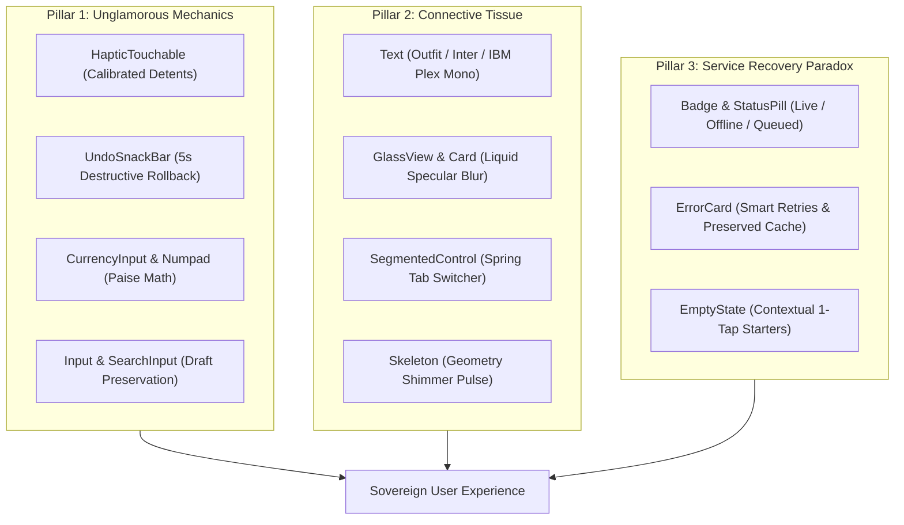

# Kalya Mobile Reusable UI Component Architecture & Plan (`apps/mobile/src/components/ui/*`)

> **Master Plan & Implementation Blueprint**
> Designed to surpass the **"Commodity Ceiling"** (Tim Gabe) in mobile fintech by implementing high-craft tactile mechanics, fluid connective tissue, and resilient service recovery patterns.

---

## 1. Executive Summary & Philosophy

Most fintech applications look superficially acceptable but feel hollow—they lack tactile weight, exhibit jarring layout shifts, treat errors as dead ends, and discard user drafts on failure.

The `@kalya/mobile` UI component library is engineered to establish **Sovereign Craft**:

1. **Every touch has physical presence:** Spring physics and calibrated tactile feedback (`expo-haptics`) confirm every interaction.
2. **Every state is continuous:** Transitions between empty, loading, populated, and offline modes are fluid, with zero layout shift.
3. **Destructive actions are safe:** Destructive operations (such as deleting an expense) enter an optimistic 5-second undo quarantine before permanent commit.
4. **Errors are collaborative troubleshooting steps:** Failures articulate what happened, affirm what local data remains safe, and provide single-tap retries.

---

## 2. Tim Gabe's 3 Pillars in the UI Component Layer



### Pillar 1: The Unglamorous Mechanics

- **Physical Haptic Feedback:** Replaces vanilla touchables with calibrated tactile resonance:
  - `light`: Soft selection detent for tabs and chips.
  - `medium`: Definite click for buttons and toggles.
  - `success`: Dual-tap haptic for biometric unlock and sync completion.
  - `warning` / `error`: Distinct double-buzz for invalid input or network timeout.
- **Micro-Spring Physics:** Buttons and touchable surfaces scale to `0.97` on press with spring damping (`stiffness: 300, damping: 15`), giving controls physical mass.
- **5-Second Destructive Reversal:** `UndoSnackBar` floats above the bottom navigation with an SVG circular timer, delaying irreversible database mutations.

### Pillar 2: Connective Tissue

- **Typographic Triad:**
  - `Outfit` for brand display headers, screen titles, and modal headers.
  - `Inter` for interface labels, form descriptions, and instructional copy.
  - `IBM Plex Mono` for currency figures, transaction amounts, timestamps, and percentages.
- **Liquid Glass Elevation:** Translucent layered surfaces (`bg-kalya-glass-base`, `border-kalya-glass-border`) with subtle specular highlights creating visual hierarchy without heavy opaque cards.
- **Zero-Layout-Shift Shimmer:** `Skeleton` loaders mimic exact component geometry (cards, pills, avatar circles, transaction rows) during TanStack Query caching cycles.

### Pillar 3: The Service Recovery Paradox

- **Ambient Vault Indicators:** Rather than an aggressive full-screen error modal when offline, `StatusPill` transitions smoothly from `[ 🔒 LIVE VAULT ]` to `[ 🛡️ VAULT MODE · OFFLINE ]`.
- **Diagnostic Error Cards:** `ErrorCard` explicitly informs the user: _"Your local data is safe. The server took too long to respond."_ and offers a clear retry trigger.
- **Actionable Empty States:** `EmptyState` provides educational guidance and a 1-tap call-to-action button to eliminate blank screen confusion.

---

## 3. Reusable UI Component Catalog & File Map

| Component File                                                                                                                              | Role & Description                                 | Primary Props & Features                                           |
| ------------------------------------------------------------------------------------------------------------------------------------------- | -------------------------------------------------- | ------------------------------------------------------------------ |
| [`haptic-touchable.tsx`](file:///Users/raushankumar/Workspace/Projects/Personal/kalya/apps/mobile/src/components/ui/haptic-touchable.tsx)   | Spring-scaled pressable with `expo-haptics`        | `hapticTier`, `scaleTo`, `onPress`, `disabled`                     |
| [`text.tsx`](file:///Users/raushankumar/Workspace/Projects/Personal/kalya/apps/mobile/src/components/ui/text.tsx)                           | Typography component with calibrated font families | `variant` (13 tiers), `tone` (8 tones)                             |
| [`glass-view.tsx`](file:///Users/raushankumar/Workspace/Projects/Personal/kalya/apps/mobile/src/components/ui/glass-view.tsx)               | Specular Liquid Glass backdrop container           | `variant`, `borderGlow`, `intensity`                               |
| [`card.tsx`](file:///Users/raushankumar/Workspace/Projects/Personal/kalya/apps/mobile/src/components/ui/card.tsx)                           | Structural surface container (solid, glass, hero)  | `variant`, `padding`, `rounded`, `onPress`                         |
| [`button.tsx`](file:///Users/raushankumar/Workspace/Projects/Personal/kalya/apps/mobile/src/components/ui/button.tsx)                       | Luxury action button & icon button                 | `variant` (7 styles), `size`, `isLoading`, `leftIcon`, `rightIcon` |
| [`input.tsx`](file:///Users/raushankumar/Workspace/Projects/Personal/kalya/apps/mobile/src/components/ui/input.tsx)                         | Form text field with focus glow & clear action     | `label`, `error`, `helperText`, `clearable`, `glowColor`           |
| [`search-input.tsx`](file:///Users/raushankumar/Workspace/Projects/Personal/kalya/apps/mobile/src/components/ui/search-input.tsx)           | Debounced search bar with loading indicator        | `onSearch`, `debounceMs`, `isSearching`, `onClear`                 |
| [`currency-input.tsx`](file:///Users/raushankumar/Workspace/Projects/Personal/kalya/apps/mobile/src/components/ui/currency-input.tsx)       | Minor-units financial currency input (paise)       | `valuePaise`, `onChangePaise`, `currencyCode`, `symbol`            |
| [`numpad.tsx`](file:///Users/raushankumar/Workspace/Projects/Personal/kalya/apps/mobile/src/components/ui/numpad.tsx)                       | Financial keypad with quick preset amount chips    | `onKeyPress`, `onBackspace`, `onClearAll`, `quickPresets`          |
| [`badge.tsx`](file:///Users/raushankumar/Workspace/Projects/Personal/kalya/apps/mobile/src/components/ui/badge.tsx)                         | Micro-indicator for 50/30/20 & vault sync states   | `variant` (10 variants), `showDot`, `pulseDot`, `size`             |
| [`segmented-control.tsx`](file:///Users/raushankumar/Workspace/Projects/Personal/kalya/apps/mobile/src/components/ui/segmented-control.tsx) | Sliding spring tab switcher                        | `value`, `options`, `onChange`, `fullWidth`                        |
| [`skeleton.tsx`](file:///Users/raushankumar/Workspace/Projects/Personal/kalya/apps/mobile/src/components/ui/skeleton.tsx)                   | Specular shimmer loading placeholder               | `width`, `height`, `rounded`, `shimmerDurationMs`                  |
| [`undo-snack-bar.tsx`](file:///Users/raushankumar/Workspace/Projects/Personal/kalya/apps/mobile/src/components/ui/undo-snack-bar.tsx)       | 5-second destructive undo pill with circular timer | `visible`, `message`, `durationMs`, `onUndo`, `onExpire`           |
| [`error-card.tsx`](file:///Users/raushankumar/Workspace/Projects/Personal/kalya/apps/mobile/src/components/ui/error-card.tsx)               | Diagnostic failure card with retry action          | `title`, `description`, `onRetry`, `onSecondaryAction`             |
| [`empty-state.tsx`](file:///Users/raushankumar/Workspace/Projects/Personal/kalya/apps/mobile/src/components/ui/empty-state.tsx)             | Contextual empty state with 1-tap call-to-action   | `illustration`, `title`, `description`, `primaryActionLabel`       |
| [`index.ts`](file:///Users/raushankumar/Workspace/Projects/Personal/kalya/apps/mobile/src/components/ui/index.ts)                           | Barrel export for all components and types         | Uniform re-exports for streamlined imports                         |

---

## 4. Component Specification & Props Contracts

### 4.1 `HapticTouchable` (`haptic-touchable.tsx`)

```typescript
export type HapticTier =
  'none' | 'light' | 'medium' | 'heavy' | 'selection' | 'success' | 'warning' | 'error';

export interface HapticTouchableProps extends PressableProps {
  /** Calibrated haptic intensity triggered on press down */
  hapticTier?: HapticTier;
  /** Spring target scale down factor (defaults to 0.97) */
  scaleTo?: number;
  /** Custom wrapper style */
  style?: StyleProp<ViewStyle>;
  /** Optional container class name for NativeWind */
  className?: string;
  /** Optional hit slop margin */
  hitSlop?: Insets | number;
}
```

### 4.2 `Text` (`text.tsx`)

```typescript
export type TextVariant =
  | 'display' // Outfit Bold, 32px
  | 'title-lg' // Outfit Bold, 24px
  | 'title-md' // Outfit Bold, 20px
  | 'title-sm' // Outfit Bold, 16px
  | 'body-lg' // Inter Regular, 16px
  | 'body-md' // Inter Regular, 14px
  | 'body-sm' // Inter Regular, 12px
  | 'caption' // Inter Regular, 11px
  | 'numeral-xl' // IBM Plex Mono Bold, 32px
  | 'numeral-lg' // IBM Plex Mono Bold, 24px
  | 'numeral-md' // IBM Plex Mono Bold, 18px
  | 'numeral-sm' // IBM Plex Mono Regular, 14px
  | 'code'; // IBM Plex Mono Regular, 12px

export type TextTone =
  'primary' | 'secondary' | 'tertiary' | 'accent' | 'inverse' | 'inflow' | 'outflow' | 'muted';

export interface TextProps extends RNTextProps {
  variant?: TextVariant;
  tone?: TextTone;
  className?: string;
}
```

### 4.3 `GlassView` & `Card` (`glass-view.tsx`, `card.tsx`)

```typescript
export type GlassVariant = 'ultra-thin' | 'base' | 'thick' | 'emerald' | 'gold';

export interface GlassViewProps extends ViewProps {
  variant?: GlassVariant;
  borderGlow?: boolean;
  className?: string;
}

export type CardVariant =
  'surface' | 'subtle' | 'glass' | 'glass-emerald' | 'hero-emerald' | 'outlined';

export interface CardProps extends ViewProps {
  variant?: CardVariant;
  padding?: 'none' | 'sm' | 'md' | 'lg' | 'xl';
  rounded?: 'sm' | 'md' | 'lg' | 'xl';
  onPress?: () => void;
  className?: string;
}
```

### 4.4 `Button` & `IconButton` (`button.tsx`)

```typescript
export type ButtonVariant =
  'primary' | 'gold' | 'glass' | 'glass-emerald' | 'outline' | 'ghost' | 'destructive';
export type ButtonSize = 'sm' | 'md' | 'lg' | 'pill';

export interface ButtonProps extends Omit<HapticTouchableProps, 'children'> {
  title: string;
  variant?: ButtonVariant;
  size?: ButtonSize;
  isLoading?: boolean;
  loadingText?: string;
  leftIcon?: React.ReactNode;
  rightIcon?: React.ReactNode;
  fullWidth?: boolean;
}

export interface IconButtonProps extends Omit<HapticTouchableProps, 'children'> {
  icon: React.ReactNode;
  variant?: ButtonVariant;
  size?: 'sm' | 'md' | 'lg';
  accessibilityLabel: string;
}
```

### 4.5 `Input` & `SearchInput` (`input.tsx`, `search-input.tsx`)

```typescript
export interface InputProps extends TextInputProps {
  label?: string;
  helperText?: string;
  error?: string | null;
  leftIcon?: React.ReactNode;
  rightIcon?: React.ReactNode;
  clearable?: boolean;
  onClear?: () => void;
  glowColor?: 'emerald' | 'gold';
}

export interface SearchInputProps extends Omit<InputProps, 'leftIcon'> {
  debounceMs?: number;
  onSearch?: (query: string) => void;
  isSearching?: boolean;
}
```

### 4.6 `CurrencyInput` & `Numpad` (`currency-input.tsx`, `numpad.tsx`)

```typescript
export interface CurrencyInputProps {
  valuePaise: number;
  onChangePaise: (paise: number) => void;
  currencyCode?: string;
  symbol?: string;
  size?: 'md' | 'lg' | 'xl';
  error?: string | null;
}

export interface NumpadProps {
  onKeyPress: (key: string) => void;
  onBackspace: () => void;
  onClearAll?: () => void;
  quickPresets?: number[];
  onSelectPreset?: (amount: number) => void;
  disableDecimal?: boolean;
}
```

### 4.7 `Badge` (`badge.tsx`)

```typescript
export type BadgeVariant =
  | 'needs' // 50% Needs Emerald (#0d3e26)
  | 'wants' // 30% Wants Gold (#d4af37)
  | 'savings' // 20% Savings Sage (#2d7a50)
  | 'inflow' // Inflow Green
  | 'outflow' // Outflow Crimson
  | 'sync-live' // Live Vault Indicator
  | 'sync-offline' // Offline Mode Indicator
  | 'sync-queued' // Queued Outbox Indicator
  | 'gold-pro' // Metallic Gold Pill
  | 'neutral'; // Slate Grey Wash

export interface BadgeProps {
  label: string;
  variant?: BadgeVariant;
  showDot?: boolean;
  pulseDot?: boolean;
  size?: 'xs' | 'sm' | 'md';
}
```

### 4.8 `UndoSnackBar` (`undo-snack-bar.tsx`)

```typescript
export interface UndoSnackBarProps {
  visible: boolean;
  message: string;
  durationMs?: number;
  onUndo: () => void;
  onExpire: () => void;
  actionLabel?: string;
}
```

### 4.9 `Skeleton` (`skeleton.tsx`)

```typescript
export interface SkeletonProps extends ViewProps {
  width?: DimensionValue;
  height?: DimensionValue;
  rounded?: 'xs' | 'sm' | 'md' | 'lg' | 'pill';
  shimmerDurationMs?: number;
}
```

### 4.10 `ErrorCard` & `EmptyState` (`error-card.tsx`, `empty-state.tsx`)

```typescript
export interface ErrorCardProps {
  title: string;
  description: string;
  onRetry?: () => void;
  retryLabel?: string;
  onSecondaryAction?: () => void;
  secondaryActionLabel?: string;
}

export interface EmptyStateProps {
  illustration?: React.ReactNode;
  title: string;
  description: string;
  primaryActionLabel?: string;
  onPrimaryAction?: () => void;
  secondaryActionLabel?: string;
  onSecondaryAction?: () => void;
}
```

### 4.11 `SegmentedControl` (`segmented-control.tsx`)

```typescript
export interface SegmentOption<T extends string> {
  value: T;
  label: string;
  badgeCount?: number;
}

export interface SegmentedControlProps<T extends string> {
  value: T;
  options: SegmentOption<T>[];
  onChange: (value: T) => void;
  fullWidth?: boolean;
}
```

---

## 5. Implementation Roadmap & Quality Checklist

1. [ ] **Design Tokens & System Matrix Alignment** (`apps/mobile/tailwind.config.js`)
2. [ ] **Foundation Primitives Implementation:**
   - `haptic-touchable.tsx`
   - `text.tsx`
   - `glass-view.tsx`
   - `card.tsx`
3. [ ] **Action & Form Primitives Implementation:**
   - `button.tsx` (includes `IconButton`)
   - `input.tsx`
   - `search-input.tsx`
   - `currency-input.tsx`
   - `numpad.tsx`
4. [ ] **Feedback & Service Recovery Primitives:**
   - `badge.tsx` (includes `StatusPill`)
   - `segmented-control.tsx`
   - `skeleton.tsx`
   - `undo-snack-bar.tsx`
   - `error-card.tsx`
   - `empty-state.tsx`
5. [ ] **Unified Barrel Export & Type Check:**
   - `index.ts` re-exporting all components, interfaces, and variant types.
   - Run `pnpm --filter @kalya/mobile exec tsc --noEmit` to verify type safety.
